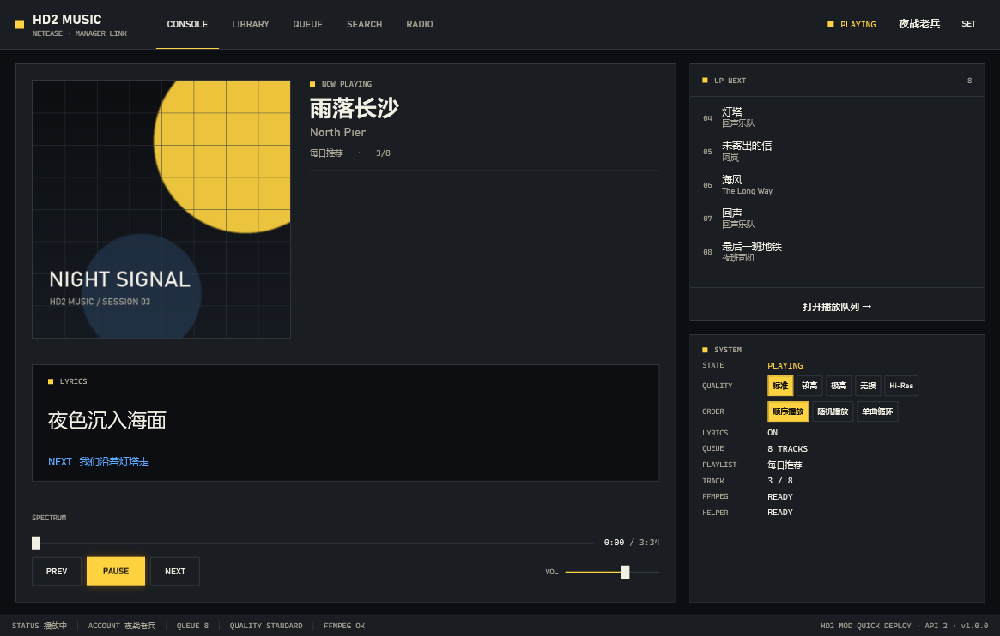

# HD2QD HD2 Music

A plugin of [HD2 Mod Quick Deploy](https://github.com/pat-pat-patrick/hd2-mod-cli): the NetEase
Cloud Music player of the **HD2 Music** mod, as a window of the manager. Sign in with a QR code,
a cookie or an SMS code; browse playlists, search, the daily recommendation, private FM, radio
and podcasts; play, seek and follow the lyrics — and the mod's in-game player, 2D/3D lyrics and
spectrum keep working, because the plugin writes the same state files the mod's helper does.



## What it does

- **Sign-in**: QR code (rendered in the plugin's own window), a `MUSIC_U` cookie, or phone +
  SMS code (`+86` default, any country code).
- **Library**: your playlists and their covers, daily recommendations, private FM, the radio
  directory and its episodes, recommended playlists, search by song or artist, queue.
- **Playback**: play/pause, previous/next, seek, volume, five quality levels (standard, higher,
  exhigh, lossless, Hi-Res), repeat/shuffle/order, gapless next-track preparation.
- **Lyrics**: line-synced, word-synced where NetEase provides it, translations; the current,
  previous and next line are published to the mod for its 2D and 3D lyrics.
- **State for the mod**: now playing, progress, queue, cover (texture, preview and mini), the
  16-band spectrum and the timed world-lyric cues — all in `ncm_state.txt`,
  `ncm_spectrum.txt` and the `.dat` cover files the mod already reads.
- **Manager integration**: the plugin's card in **Plugins**, the command `hd2music`, a body handed
  to the manager's own window frame (`host["window"]`), and the manager's own tokens
  (Ground900/700, Grid, Ink, Muted, Yellow, Blue, Bahnschrift + YaHei UI, Ghost/Primary buttons)
  through the shared `Theme`/`Ui.xaml` component set.

## The window

One command bar, five views, no sidebar and no separate player strip:

- **CONSOLE** — the cover, the current line and its translation with the next line under it, the
  16-band spectrum the mod also draws in game, the transport and the volume; on the right, the
  next five tracks and a SYSTEM panel: state, **quality and order as segmented switches**,
  lyrics, queue, playlist, position, ffmpeg and the helper lock.
- **LIBRARY** — playlist cards as numbered tiles; **QUEUE** and **SEARCH** — two-line track tables
  (title over artist) with the current row in yellow; **RADIO** — channels on the left, episodes
  on the right.
- The gear opens a settings sheet over the same window (lyrics, decoder, account, about);
  quality and order live in the console's SYSTEM panel, where they are one click away. Esc
  closes the sheet. The status strip carries the current reason (reading a playlist, buffering,
  …), account, queue, quality, ffmpeg and the version in mono.

Cards are grid-lined ground, section labels are small caps with a yellow square, numbers are
mono, and yellow is the only accent — the manager's own board, not a stock WPF window.

## Install

1. HD2 Mod Quick Deploy **0.15.0 or later** (plugin Api 2).
2. **Plugins** page → **Add plugin…** → `HD2QD.HD2Music.dll` (or drop the file on the page).
3. Deploy **HD2 Music** in Arsenal, start the game, then open **HD2 Music** on the Plugins page.
4. The decoder travels inside the DLL: FFmpeg 6.1.1 essentials (~79 MB) is written once, next
   to the plugin or into the player's settings folder, when neither has an `ffmpeg.exe`. An
   existing file beside the plugin, in the settings folder, or chosen on the **设置** page is
   used instead (`ncm_ffmpeg.txt` remembers it); `HD2MUSIC_FFMPEG` overrides everything.

The plugin and the mod's Python helper (`网易云在线助手`) **cannot run at the same time**: both
take `%LOCALAPPDATA%\HD2Phone\ncm_helper.lock`, and both write the same state files. The plugin
starts that helper's lock lazily — only when the window or a command is used, never at manager
launch. If the helper is already running, the window says so and publishes nothing.

## What it reads and writes

Under `%LOCALAPPDATA%\HD2Phone`:

| File | Use |
|---|---|
| `ncm_state.txt` | Written every 200 ms: the mod's whole in-game state (see *Compatibility*). |
| `ncm_spectrum.txt` | Written about 28 times a second: the 16 spectrum bands. |
| `ncm_cover_preview.dat`, `ncm_cover_texture.dat`, `ncm_mini_cover.dat` | Cover art for the mod (360/200/80 px paths). |
| `ncm_recommend_*.dat` | Recommended-playlist cover tiles, at most 24 kept. |
| `ncm_session.json` | The NetEase cookies; written only when you sign in. |
| `ncm_pending_login.json` | The QR login session while a QR is on screen. |
| `ncm_lyrics_enabled.txt`, `ncm_quality.txt`, `ncm_order.txt`, `ncm_automix.txt`, `ncm_ffmpeg.txt` | The plugin's own settings, the same names the helper uses. |
| `ffmpeg.exe` | Written next to the plugin (or in this folder) from the packed copy when none exists; the decoder the player spawns. |
| `ncm_helper.lock` | The single-instance lock shared with the helper. |
| `ncm_game_alive.txt` | **Read** only: the mod's heartbeat. Playback is refused without it. |

Elsewhere:

- `%USERPROFILE%\.hd2-mod-cli\plugins` — the plugin file itself, the path the manager installs it to.
- The temporary audio pipe between `ffmpeg.exe` and the player (no file is kept).

**Hosts it contacts** (no telemetry, no update check, nothing else):

- `music.163.com`, `interface.music.163.com` — sign-in, playlists, search, lyrics, stream URLs;
- `*.music.126.net`, `*.music.163.com` — cover images and the audio streams themselves;
- `space.bilibili.com` — only if you click the mod author's link on the **关于** page.

## Compatibility

The state writer was checked field by field against `ncm_online_helper.py` 1.2.3's `publish()`:
every row the mod uses for the current song, progress, lyrics (line, word marks, translation,
timed world cues), queue, cover keys, playlist/recommend/radio/podcast/search lists and the
spectrum is written. These optional in-game **paging/filter** rows are not, because this player
loads a fixed page instead of paging: `search_more`, `search_offset`, `radio_keyword`,
`podcast_filter`, `podcast_filter_serial`, `recommend_more`, `account_loading`. The in-game
"load more" affordances for those lists therefore do nothing; everything else matches.

The player also refuses to play when the mod's heartbeat (`ncm_game_alive.txt`) is absent, which
is the mod's own rule: start the game, deploy HD2 Music, keep the manager running.

## Command line

```
hd2music                  status: account, song, queue, position, ffmpeg, notice
hd2music play|pause|toggle
hd2music next|prev|stop
hd2music search <words>
hd2music login            start QR sign-in
hd2music lyrics 0|1
hd2music vol 0-100
```

`status` returns `0`; a refused action `1`; a wrong command line `2`.

## Build

Needs the .NET SDK 8 or later (`dotnet` on `PATH`, or set `DOTNET`):

```
build.bat
```

It builds `release\HD2QD.HD2Music.dll`, then runs `tests\Verify.exe`, which loads the file the way
the manager does (bytes, not `LoadFrom`), checks the contract (`Api` 2, `Kind` `window`, the one
public `Plugin`, `Title`/`Summary` in both languages), the embedded icon and text, that only .NET
Framework assemblies are referenced, and builds both windows off-screen and lays them out. It
needs no game, network or manager.

Current output:

```
  ok   assembly name HD2QD.HD2Music, version 1.0.0
  ok   target framework .NETFramework,Version=v4.8
  ok   Api = 2 (a const the manager reads before running any code)
  ok   Kind = window
  ok   embedded Lang.en.json, Lang.zh-CN.json, Ui.xaml, app.ico, QRCoder.dll, ffmpeg.exe.gz
  ok   references only .NET Framework assemblies (8)
  ok   QR encoder embedded (QRCoder, MIT): 29x29 matrix, no QRCoder.dll on disk
  ok   embedded ffmpeg extracted to a temp folder: 78 MB, SHA-256 matches
  ok   player view built off-screen and laid out on #0C0E11
  ok   opens in the manager's frame: "HD2 音乐"
  ok   login window built off-screen and laid out: "登录 · HD2 音乐"
OK: all checks passed
```

Runtime dependencies: .NET Framework 4.8 (part of Windows 10/11), `System.Web.Extensions`
(part of the framework) and WPF. Nothing else has to be installed: the QR encoder (QRCoder
1.4.3, MIT) and FFmpeg 6.1.1 essentials (GPLv3) travel inside the DLL; FFmpeg is extracted on
first use and checked against its packed SHA-256. See [THIRD-PARTY-NOTICES.md](THIRD-PARTY-NOTICES.md).

## Licence and credits

MIT — see [LICENSE](LICENSE).

- **HD2 Music** and its `网易云在线助手` are the work of [@127_MU](https://space.bilibili.com/283469182);
  this plugin is an unofficial companion that brings the helper's features into the manager.
- The manager, its plugin contract and its theme are [pat-pat-patrick](https://github.com/pat-pat-patrick/hd2-mod-cli)'s.
- The NetEase Web API request shape (`weapi`) follows the public reverse-engineered protocol used
  by the helper and other open clients. NetEase Cloud Music is a service of NetEase, Inc.; this
  plugin is not affiliated with it.
- QR encoding: [QRCoder](https://github.com/codebude/QRCoder) 1.4.3 (MIT), by Raffael Herrmann,
  embedded in the DLL and loaded from bytes.
- The bundled decoder is FFmpeg 6.1.1-essentials_build (gyan.dev), GPLv3, extracted at run
  time; it is a separate program, not part of this MIT-licensed code. Source and licence:
  [THIRD-PARTY-NOTICES.md](THIRD-PARTY-NOTICES.md).

---

# HD2 音乐 · 管理器插件

[HD2 Mod Quick Deploy](https://github.com/pat-pat-patrick/hd2-mod-cli) 的插件：把 **HD2 Music**
模组的网易云在线助手搬进管理器窗口。扫码、Cookie 或短信登录；歌单、搜索、每日推荐、私人 FM、
电台播客；播放、拖动进度、歌词同步。插件写入与助手相同的状态文件，因此游戏内播放器、2D/3D
歌词和频谱照常工作。

- 安装：管理器 0.15.0 以上 → 插件页 → 添加 `HD2QD.HD2Music.dll`。
- 解码器已随 DLL 打包（FFmpeg 6.1.1 essentials，约 79 MB）：首次启动若插件旁与管理器设置目录
  都没有 `ffmpeg.exe`，插件会自动释放一份并校验 SHA-256；已有文件或「设置」页选择的路径优先。
- 插件与压缩包里的 Python 助手**不能同时运行**（共用 `ncm_helper.lock`）；插件只在打开窗口或
  执行命令时才占锁，不会在管理器启动时抢占。
- 状态字段与助手 1.2.3 的 `publish()` 逐项对照；游戏内“加载更多”相关的分页字段未写入，
  其余当前歌曲、歌词、队列、封面、频谱均一致。

构建：`build.bat`，产物 `release\HD2QD.HD2Music.dll`，并自动运行 `tests\Verify.exe` 检查契约、
资源、依赖与窗口构造。
